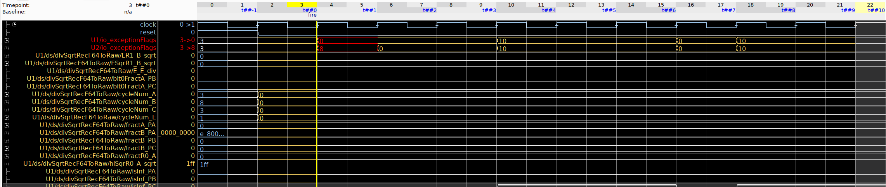

# BOOM_DivSqrtRecF64

*Note*: The source code of the DivSqrtRecF64 may contain arbitrary signals or behavior introduced during LLM-based code generation.

-----------
"Documentation of this functional unit:
https://github.com/ucb-bar/berkeley-hardfloat/blob/master/doc/divSqrtRecodedFloat64_mulAddZ31.txt

In above file, we can find information about the latency:
"From the beginning of the starting clock cycle to the end of the final
cycle, a single operation has the following latency:

    division:     19 cycles or less;
    square root:  27 cycles or less.

Latencies shorter than the maximum occur only for special cases, such as
when the argument of a square root is negative. The minimum special-case
latency is 2 cycles, for either division or square root."

UPEC-DIT shows these special cases as counterexamples, usually where one instance receives zero as an operand." *
*: https://github.com/Mustafa-Taleb18/UPEC-DIT/blob/master/examples/processor-cores/BOOM/functional-units/DivSqrtRecF64/DivSqrtRecF64_dit.sva
--------------

**UPEC-TOOL Results**

Violation of data-dependent timing

**OneSpin Results**
The original DivSqrtRecF64 RTL and the BOOM source RTL (consisting of three files) produced the same counterexample.

**Design Interface**

Input Signals:
io_a [65]
io_b [65]
io_inValid [1]
io_roundingMode [3]
io_sqrtOp [1]

Output Signals:
io_exceptionFlags [5]
io_inReady_div	[1]
io_inReady_sqrt	[1]
io_out [65]
io_outValid_div	[1]
io_outValid_sqrt [1]

