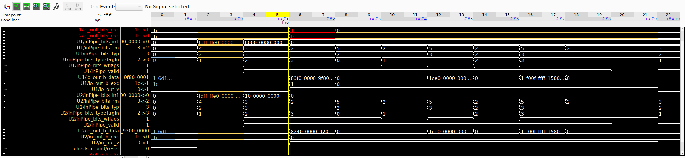

# BOOM_IntToFP

*Note*: The source code of the IntToFP may contain arbitrary signals or behavior introduced during LLM-based code generation.

UPEC-DIT confirmed that the The valid signal (and therefore also the timing) of the module is data-independent.
However, the exception flags are data-dependent, which might still cause a side-effect.

**UPEC-TOOL Results**

Control behavior independent of data inputs with valid

Violation of data-dependent timing found with flags 

**OneSpin Results**
The original FPU RTL and the BOOM source RTL (consisting of three files) produced the same counterexample.

**Design Interface**

Input Signals:
io_in_bits_in1 [64]
io_in_bits_rm [3]
io_in_bits_typ [2]
io_in_bits_typeTagIn [2]
io_in_bits_wflags [1]
io_in_valid [1]

Output Signals:
io_out_bits_data [65]
io_out_bits_exec [5]
io_out_valid [1]
