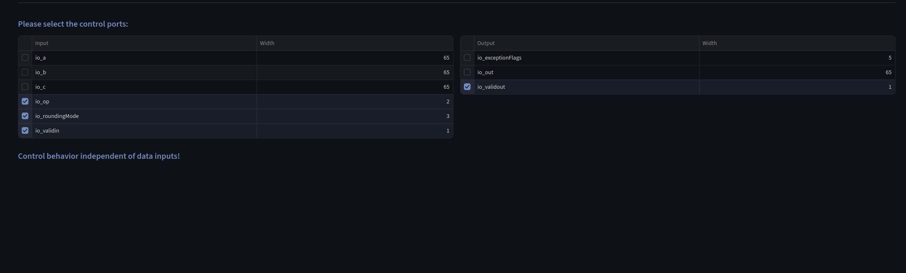
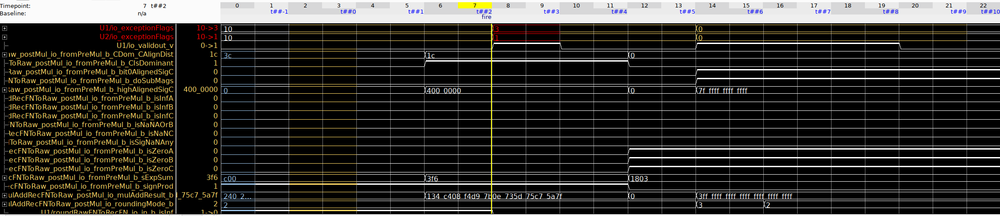

# BOOM_MulAddRecFNPipe

*Note*: The source code of the MulAddRecFNPipe may contain arbitrary signals or behavior introduced during LLM-based code generation.

UPEC-DIT confirmed that the The valid signal (and therefore also the timing) of the module is data-independent.
However, the exception flags are data-dependent, which might still cause a side-effect.

**UPEC-TOOL Results**

Control behavior independent of data inputs with valid

Violation of data-dependent timing found with flags 

**OneSpin Results**
The original MulAddRecFNPipe RTL and the BOOM source RTL (consisting of three files) produced the same counterexample.

**Design Interface**

Input Signals:
io_a [65]
io_b [65]
io_c [65]
io_op [2]
io_roundingMode [3]
io_validin [1]

Output Signals:
io_exceptionFlags [5]
io_out [65]
io_validout [1]
